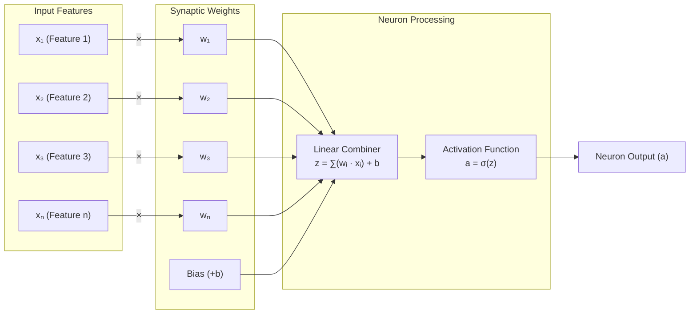
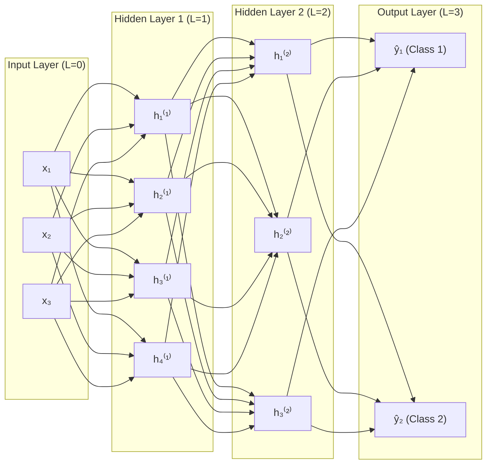
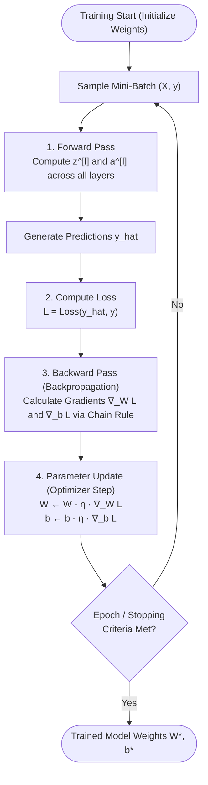
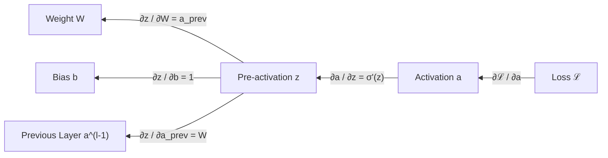
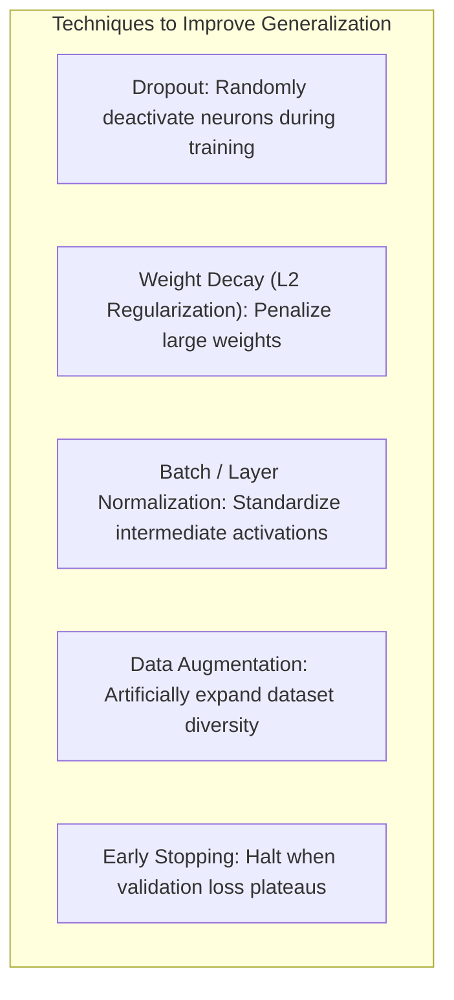
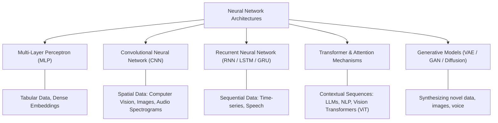

# Comprehensive Guide to Neural Networks (with PyTorch Architecture & Implementation)

---

## Table of Contents
1. [Introduction to Neural Networks](#1-introduction-to-neural-networks)
2. [Anatomy of a Single Neuron (Perceptron)](#2-anatomy-of-a-single-neuron-perceptron)
   - Mathematical Formulation
   - Visual Diagram of a Neuron
3. [Multi-Layer Perceptrons (MLP) & Deep Networks](#3-multi-layer-perceptrons-mlp--deep-networks)
   - Network Layers (Input, Hidden, Output)
   - Network Topology Diagram
   - Forward Propagation in Matrix Notation
4. [Activation Functions](#4-activation-functions)
   - Why Non-Linearity is Essential
   - Common Activation Functions (Sigmoid, Tanh, ReLU, GELU, Softmax)
   - Comparison Matrix
5. [The Learning Process: End-to-End Training Pipeline](#5-the-learning-process-end-to-end-training-pipeline)
   - Visual Training Flowchart
   - Step-by-Step Breakdown
6. [Loss Functions (Objective Functions)](#6-loss-functions-objective-functions)
   - Regression Losses
   - Classification Losses
7. [Backpropagation & Optimization](#7-backpropagation--optimization)
   - The Chain Rule of Calculus
   - Gradient Descent & Modern Optimizers (SGD, Adam, AdamW)
8. [Preventing Overfitting: Regularization & Normalization](#8-preventing-overfitting-regularization--normalization)
   - Dropout, Weight Decay ($L_1 / L_2$), Batch Normalization, Early Stopping
9. [Major Neural Network Architectures](#9-major-neural-network-architectures)
   - MLP, CNN, RNN/LSTM, Transformers
10. [Complete PyTorch Implementation](#10-complete-pytorch-implementation)
    - Code Example: Data, Model (`nn.Module`), Loss, Optimizer & Training Loop
11. [Summary & Quick Reference Cheat Sheet](#11-summary--quick-reference-cheat-sheet)

---

## 1. Introduction to Neural Networks

An **Artificial Neural Network (ANN)** is a computational model inspired by the biological neural circuits in human brains. At its core, a neural network is a parameterized function approximator:

$$y = f(\mathbf{x}; \mathbf{\Theta})$$

Where:
- $\mathbf{x}$ is the input feature vector.
- $\mathbf{\Theta} = \{\mathbf{W}, \mathbf{b}\}$ represents the trainable parameters (weights and biases).
- $y$ is the predicted output (target label or continuous quantity).

According to the **Universal Approximation Theorem**, a feedforward neural network with a single hidden layer containing a finite number of neurons and non-linear activation functions can approximate any continuous function on compact subsets of $\mathbb{R}^n$ to arbitrary precision.

---

## 2. Anatomy of a Single Neuron (Perceptron)

The foundational building block of any neural network is the **artificial neuron** (or node).

```
   Inputs       Weights
   [ x₁ ] -----( w₁ )-----\
   [ x₂ ] -----( w₂ )------\    Summation        Activation
                             --> [ ∑ wᵢxᵢ + b ] -> [ σ(z) ] -> Output (a)
   [ ... ] ----( ... )-----/
   [ xₙ ] -----( wₙ )-----/
   [ Bias b ] ------------/
```

### Mathematical Formulation

1. **Linear Combination (Pre-activation $z$):**
   $$z = \sum_{i=1}^{n} w_i x_i + b = \mathbf{w}^T \mathbf{x} + b$$
   - $\mathbf{x} = [x_1, x_2, \dots, x_n]^T$: Input vector
   - $\mathbf{w} = [w_1, w_2, \dots, w_n]^T$: Weight vector (strength/importance of each input)
   - $b$: Scalar bias term (allows shifting the activation threshold away from the origin)

2. **Non-linear Transformation (Activation $a$):**
   $$a = \sigma(z) = \sigma(\mathbf{w}^T \mathbf{x} + b)$$
   - $\sigma(\cdot)$: Non-linear activation function

### Mermaid Diagram: Single Artificial Neuron



---

## 3. Multi-Layer Perceptrons (MLP) & Deep Networks

When multiple neurons are stacked horizontally, they form a **Layer**. When multiple layers are cascaded sequentially, they form a **Deep Neural Network (DNN)** or **Multi-Layer Perceptron (MLP)**.

### Layers in a Network

1. **Input Layer:** Receives raw feature vectors. Does not compute activations.
2. **Hidden Layer(s):** Intermediate computational representations that extract increasingly abstract hierarchical features (e.g., edges $\to$ textures $\to$ object parts $\to$ whole objects).
3. **Output Layer:** Produces final model inferences (class logits, probabilities, or continuous real values).

### Mermaid Diagram: Multi-Layer Architecture



### Forward Propagation in Matrix Notation

For layer $l \in \{1, 2, \dots, L\}$:

$$\mathbf{z}^{[l]} = \mathbf{W}^{[l]} \mathbf{a}^{[l-1]} + \mathbf{b}^{[l]}$$
$$\mathbf{a}^{[l]} = \sigma^{[l]}(\mathbf{z}^{[l]})$$

Where:
- $\mathbf{a}^{[0]} = \mathbf{x}$ (Input feature vector)
- $\mathbf{W}^{[l]}$ is the weight matrix of shape $(n^{[l]}, n^{[l-1]})$
- $\mathbf{b}^{[l]}$ is the bias vector of shape $(n^{[l]}, 1)$
- $\mathbf{z}^{[l]}$ is the pre-activation vector of shape $(n^{[l]}, 1)$
- $\mathbf{a}^{[l]}$ is the post-activation vector of shape $(n^{[l]}, 1)$
- $\hat{\mathbf{y}} = \mathbf{a}^{[L]}$ (Final network prediction)

---

## 4. Activation Functions

### Why Non-Linearity is Essential
If all activations were linear ($\sigma(z) = z$), then stacking $L$ layers:
$$\mathbf{a}^{[L]} = \mathbf{W}^{[L]}(\mathbf{W}^{[L-1]} \dots (\mathbf{W}^{[1]}\mathbf{x} + \mathbf{b}^{[1]}) + \dots ) + \mathbf{b}^{[L]} = \mathbf{W}_{\text{effective}}\mathbf{x} + \mathbf{b}_{\text{effective}}$$
No matter how many hidden layers are stacked, a linear neural network is strictly equivalent to a single-layer linear regression model. Non-linear activation functions allow networks to learn non-convex, highly complex decision boundaries.

### Common Activation Functions

| Function | Mathematical Formula | Output Range | Key Characteristics | Typical Use Case |
| :--- | :--- | :--- | :--- | :--- |
| **Sigmoid** | $\sigma(z) = \frac{1}{1 + e^{-z}}$ | $(0, 1)$ | S-shaped, smooth curve; suffers from **vanishing gradient** when $|z| \gg 0$; not zero-centered. | Binary classification output layer |
| **Tanh** | $\tanh(z) = \frac{e^z - e^{-z}}{e^z + e^{-z}}$ | $(-1, 1)$ | Zero-centered version of Sigmoid; still suffers from vanishing gradients at extremes. | Hidden layers in legacy architectures, RNNs |
| **ReLU** | $\text{ReLU}(z) = \max(0, z)$ | $[0, \infty)$ | Computationally efficient; derivative is $1$ for $z>0$ (avoids vanishing gradient); can cause **Dying ReLU** ($z \le 0$). | Standard default for hidden layers |
| **Leaky ReLU** | $\text{LReLU}(z) = \max(\alpha z, z), \alpha \approx 0.01$ | $(-\infty, \infty)$ | Prevents dead neurons by retaining a small gradient when $z < 0$. | Hidden layers when dying ReLU is observed |
| **GELU** | $\text{GELU}(z) = z \cdot \Phi(z)$ | $[-0.17, \infty)$ | Smooth probabilistic gating; weights inputs by probability of being greater than standard normal distribution. | Transformers, BERT, GPT, Modern LLMs |
| **Softmax** | $\text{Softmax}(z_i) = \frac{e^{z_i}}{\sum_{j} e^{z_j}}$ | $(0, 1), \sum=1$ | Normalizes arbitrary raw logits into a valid categorical probability distribution. | Multi-class classification output layer |

---

## 5. The Learning Process: End-to-End Training Pipeline

Neural network training follows an iterative optimization cycle:



### The 4 Phases of Every Step:
1. **Forward Pass:** The input features $\mathbf{X}$ pass through each layer to compute activations until the final predictions $\hat{\mathbf{y}}$ are generated.
2. **Loss Calculation:** A loss function measures the discrepancy between predictions $\hat{\mathbf{y}}$ and ground-truth targets $\mathbf{y}$.
3. **Backward Pass (Backpropagation):** The chain rule recursively computes the gradient of the loss with respect to every weight $\frac{\partial \mathcal{L}}{\partial \mathbf{W}}$ and bias $\frac{\partial \mathcal{L}}{\partial \mathbf{b}}$.
4. **Optimization:** An optimization algorithm (e.g., Adam or SGD) updates parameters in the direction that minimizes the loss.

---

## 6. Loss Functions (Objective Functions)

The loss function quantifies model error for a single sample, while the **Cost Function** $J(\mathbf{\Theta})$ averages the loss over a batch of $N$ samples: $J(\mathbf{\Theta}) = \frac{1}{N}\sum_{i=1}^N \mathcal{L}(\hat{y}^{(i)}, y^{(i)})$.

### 1. Regression Tasks
- **Mean Squared Error (MSE / $L_2$ Loss):**
  $$\mathcal{L}_{\text{MSE}}(y, \hat{y}) = \frac{1}{2}(y - \hat{y})^2$$
  *Properties:* Highly penalizes large outliers due to quadratic term; differentiable everywhere.
- **Mean Absolute Error (MAE / $L_1$ Loss):**
  $$\mathcal{L}_{\text{MAE}}(y, \hat{y}) = |y - \hat{y}|$$
  *Properties:* Robust to outliers, but gradient is non-smooth at $y = \hat{y}$.
- **Huber / Smooth $L_1$ Loss:** Combines the best of MSE (smooth near zero) and MAE (linear for large errors).

### 2. Classification Tasks
- **Binary Cross-Entropy (BCE Loss):**
  $$\mathcal{L}_{\text{BCE}}(y, \hat{y}) = - \Big[ y \log(\hat{y}) + (1 - y) \log(1 - \hat{y}) \Big]$$
  Used when $y \in \{0, 1\}$ and $\hat{y} \in (0, 1)$ (output of Sigmoid).
- **Categorical Cross-Entropy (Multi-Class Loss):**
  $$\mathcal{L}_{\text{CCE}}(\mathbf{y}, \hat{\mathbf{y}}) = - \sum_{k=1}^{K} y_k \log(\hat{y}_k)$$
  Used for mutually exclusive classes where $\hat{\mathbf{y}}$ is the output of Softmax and $\mathbf{y}$ is one-hot encoded.

---

## 7. Backpropagation & Optimization

### The Chain Rule of Calculus

Consider a simple computational graph: $x \to z \to a \to \mathcal{L}$.
To compute how the final loss changes with respect to a weight $w$:

$$\frac{\partial \mathcal{L}}{\partial w} = \frac{\partial \mathcal{L}}{\partial a} \cdot \frac{\partial a}{\partial z} \cdot \frac{\partial z}{\partial w}$$

For layer $l$ in a deep network:
$$\boldsymbol{\delta}^{[l]} = \frac{\partial \mathcal{L}}{\partial \mathbf{z}^{[l]}} = \left( (\mathbf{W}^{[l+1]})^T \boldsymbol{\delta}^{[l+1]} \right) \odot {\sigma^{[l]}}'(\mathbf{z}^{[l]})$$
$$\frac{\partial \mathcal{L}}{\partial \mathbf{W}^{[l]}} = \boldsymbol{\delta}^{[l]} (\mathbf{a}^{[l-1]})^T, \qquad \frac{\partial \mathcal{L}}{\partial \mathbf{b}^{[l]}} = \boldsymbol{\delta}^{[l]}$$

Where $\odot$ represents the Hadamard (element-wise) product.



### Gradient Descent Variants

1. **Standard / Batch Gradient Descent:** Computes gradients over the entire dataset at once. Stable but computationally slow and memory-intensive.
2. **Stochastic Gradient Descent (SGD):** Updates weights for every individual sample. Fast and breaks local minima, but creates high oscillation.
3. **Mini-Batch Gradient Descent:** Computes updates over mini-batches (e.g., batch sizes of 32, 64, 128, 256). The gold standard for modern deep learning.

### Modern Optimizers

- **SGD with Momentum:** Adds a fraction $\beta$ of previous velocity to dampen oscillations and accelerate through flat ravines:
  $$v_t = \beta v_{t-1} + (1 - \beta) \nabla_\theta \mathcal{L}, \quad \theta \leftarrow \theta - \eta v_t$$
- **RMSprop:** Adapts the learning rate individually per parameter by dividing by the running root-mean-square of past gradients.
- **Adam (Adaptive Moment Estimation):** Combines Momentum (first moment $m_t$) and RMSprop (second moment $v_t$) with bias correction:
  $$m_t = \beta_1 m_{t-1} + (1-\beta_1) g_t, \quad v_t = \beta_2 v_{t-1} + (1-\beta_2) g_t^2$$
  $$\hat{m}_t = \frac{m_t}{1 - \beta_1^t}, \quad \hat{v}_t = \frac{v_t}{1 - \beta_2^t}, \quad \theta_{t+1} = \theta_t - \frac{\eta}{\sqrt{\hat{v}_t} + \epsilon} \hat{m}_t$$
- **AdamW:** Decouples weight decay regularization from the gradient update step, significantly improving generalization.

---

## 8. Preventing Overfitting: Regularization & Normalization

When a deep neural network memorizes training noise instead of discovering generalizable patterns, it **overfits**.



1. **Dropout:** During each training step, randomly drops individual neurons with probability $p$ (e.g., $p=0.5$). Prevents co-adaptation of features; acts like an implicit ensemble of sub-networks.
2. **Weight Decay ($L_2$ Regularization):** Adds $\frac{\lambda}{2} \|\mathbf{W}\|_2^2$ to the loss function, pulling weights toward zero and smoothing decision surfaces.
3. **Batch Normalization (BatchNorm):** Normalizes activations across the mini-batch to have zero mean and unit variance, followed by learnable scaling $\gamma$ and shift $\beta$:
   $$\hat{x} = \frac{x - \mu_B}{\sqrt{\sigma_B^2 + \epsilon}}, \quad y = \gamma \hat{x} + \beta$$
   Dramatically stabilizes deep layer training and enables higher learning rates.
4. **Early Stopping:** Tracks loss on a held-out validation set, saving model checkpoints and terminating training when validation loss stops decreasing.

---

## 9. Major Neural Network Architectures



---

## 10. Complete PyTorch Implementation

Below is a complete, modular, and production-ready PyTorch script demonstrating model definition, data preparation, loss functions, optimizer, and the training/validation loop.

```python
import torch
import torch.nn as nn
import torch.optim as optim
from torch.utils.data import DataLoader, TensorDataset

# =====================================================================
# 1. Device Configuration (CUDA GPU, Apple MPS, or CPU)
# =====================================================================
device = torch.device("cuda" if torch.cuda.is_available() else "cpu")
print(f"Using compute device: {device}")

# =====================================================================
# 2. Define the Neural Network Architecture
# =====================================================================
class DeepClassifier(nn.Module):
    """
    Multi-Layer Perceptron with Batch Normalization and Dropout.
    Architecture:
        Linear(input_dim -> 64) -> BatchNorm -> ReLU -> Dropout(0.2)
        Linear(64 -> 32)        -> BatchNorm -> ReLU -> Dropout(0.2)
        Linear(32 -> num_classes)
    """
    def __init__(self, input_dim: int, num_classes: int):
        super(DeepClassifier, self).__init__()
        
        self.network = nn.Sequential(
            # Layer 1
            nn.Linear(input_dim, 64),
            nn.BatchNorm1d(64),
            nn.ReLU(),
            nn.Dropout(p=0.2),
            
            # Layer 2
            nn.Linear(64, 32),
            nn.BatchNorm1d(32),
            nn.ReLU(),
            nn.Dropout(p=0.2),
            
            # Output Layer (produces raw unnormalized logits)
            nn.Linear(32, num_classes)
        )

    def forward(self, x: torch.Tensor) -> torch.Tensor:
        """Forward pass through the sequential layers."""
        return self.network(x)


# =====================================================================
# 3. Synthetic Data Preparation
# =====================================================================
torch.manual_seed(42)
N_SAMPLES = 1000
N_FEATURES = 20
N_CLASSES = 3

# Generate random features and categorical labels
X_data = torch.randn(N_SAMPLES, N_FEATURES)
y_data = torch.randint(0, N_CLASSES, (N_SAMPLES,))

# Create PyTorch Dataset & DataLoader
dataset = TensorDataset(X_data, y_data)
train_loader = DataLoader(dataset, batch_size=32, shuffle=True)

# =====================================================================
# 4. Instantiate Model, Loss Function & Optimizer
# =====================================================================
model = DeepClassifier(input_dim=N_FEATURES, num_classes=N_CLASSES).to(device)

# CrossEntropyLoss automatically applies Softmax internally + computes NLLLoss
criterion = nn.CrossEntropyLoss()

# Modern AdamW optimizer with weight decay
optimizer = optim.AdamW(model.parameters(), lr=1e-3, weight_decay=1e-2)

# =====================================================================
# 5. Training Loop
# =====================================================================
NUM_EPOCHS = 10

print("\n--- Starting Training ---")
for epoch in range(1, NUM_EPOCHS + 1):
    model.train()  # Set model to training mode (enables Dropout & BatchNorm tracking)
    running_loss = 0.0
    correct = 0
    total = 0

    for batch_x, batch_y in train_loader:
        # Move batch tensors to target device
        batch_x = batch_x.to(device)
        batch_y = batch_y.to(device)

        # Step A: Clear residual gradients from previous iteration
        optimizer.zero_grad()

        # Step B: Forward Pass
        logits = model(batch_x)

        # Step C: Compute Loss
        loss = criterion(logits, batch_y)

        # Step D: Backward Pass (Autograd Chain Rule)
        loss.backward()

        # Step E: Optimizer Step (Update Weights)
        optimizer.step()

        # Track batch statistics
        running_loss += loss.item() * batch_x.size(0)
        _, preds = torch.max(logits, dim=1)
        correct += (preds == batch_y).sum().item()
        total += batch_y.size(0)

    epoch_loss = running_loss / total
    epoch_acc = (correct / total) * 100.0
    print(f"Epoch [{epoch:02d}/{NUM_EPOCHS:02d}] - Loss: {epoch_loss:.4f} | Accuracy: {epoch_acc:.2f}%")


# =====================================================================
# 6. Inference (Evaluation Mode)
# =====================================================================
model.eval()  # Set model to evaluation mode (disables Dropout, freezes BatchNorm stats)
with torch.no_grad():  # Disable gradient computation graph to save memory and compute
    sample_input = torch.randn(2, N_FEATURES).to(device)
    raw_logits = model(sample_input)
    probabilities = torch.softmax(raw_logits, dim=-1)
    predicted_classes = torch.argmax(probabilities, dim=-1)

print("\n--- Inference Output ---")
print(f"Sample Probabilities:\n{probabilities.cpu().numpy()}")
print(f"Predicted Class Indices: {predicted_classes.cpu().numpy()}")
```

---

## 11. Summary & Quick Reference Cheat Sheet

| Step | PyTorch Method | Mathematical Concept |
| :--- | :--- | :--- |
| **Model Definition** | `class Net(nn.Module)` | Defines the parameterized mapping function $f_\mathbf{\Theta}(\mathbf{x})$ |
| **Linear Layer** | `nn.Linear(in_features, out_features)` | Affine transformation $\mathbf{z} = \mathbf{W}\mathbf{x} + \mathbf{b}$ |
| **Activation** | `nn.ReLU()`, `nn.GELU()`, `nn.Sigmoid()` | Non-linear transform $\mathbf{a} = \sigma(\mathbf{z})$ enabling arbitrary representation |
| **Loss** | `criterion(predictions, targets)` | Quantifies difference between prediction $\hat{\mathbf{y}}$ and true target $\mathbf{y}$ |
| **Gradient Reset** | `optimizer.zero_grad()` | Sets $\nabla_{\mathbf{\Theta}} = 0$ (prevents gradient accumulation) |
| **Autograd** | `loss.backward()` | Computes $\frac{\partial \mathcal{L}}{\partial \mathbf{W}}$ and $\frac{\partial \mathcal{L}}{\partial \mathbf{b}}$ via backpropagation |
| **Update** | `optimizer.step()` | Adjusts parameters: $\mathbf{\Theta} \leftarrow \mathbf{\Theta} - \eta \cdot \Delta \mathbf{\Theta}$ |
| **Train Mode** | `model.train()` | Enables active behavior for `nn.Dropout` and `nn.BatchNorm` |
| **Eval Mode** | `model.eval()` | Disables dropout and switches normalization layers to running statistics |
| **No Grads** | `with torch.no_grad():` | Skips graph computation during validation/inference to conserve RAM/VRAM |
