# Machine Learning

Machine Learning is broadly categorized into three core learning paradigms based on the presence, nature, and timing of feedback:

---

## 1. Supervised Learning

### Definition
**Supervised Learning** is a paradigm where an algorithm learns a mapping function from input features ($X$) to target labels ($y$) using a labeled dataset. During training, the model's predictions are compared against ground-truth labels to compute an error/loss, which guides iterative optimization until high predictive accuracy is achieved.

* **Data Type:** Labeled data $(X, y)$
* **Primary Tasks:**
  * **Classification:** Predicting discrete category labels (e.g., spam vs. non-spam, disease diagnosis).
  * **Regression:** Predicting continuous numeric values (e.g., housing prices, stock forecast).
* **Common Algorithms:** Linear/Logistic Regression, Decision Trees, Random Forests, Support Vector Machines (SVM), Neural Networks.

### Concept Illustration
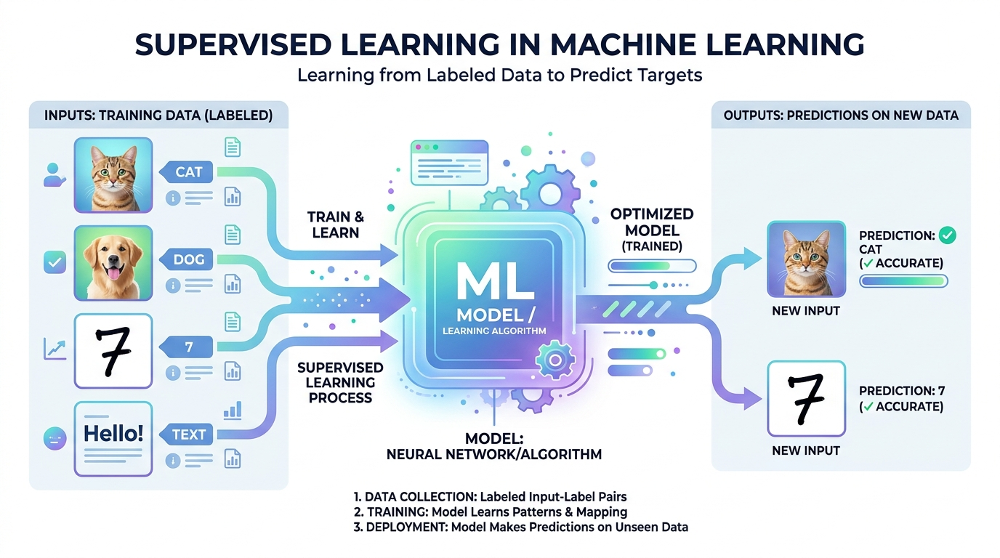

### Workflow Graph
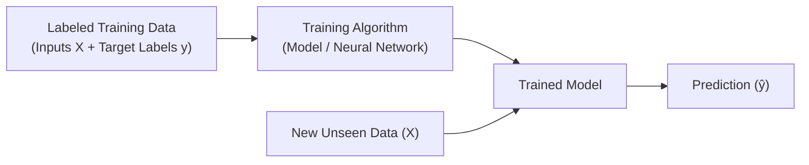

---

## 2. Unsupervised Learning

### Definition
**Unsupervised Learning** is a paradigm where an algorithm analyzes and discovers underlying structures, patterns, or groupings within an unlabeled dataset ($X$) without human guidance or pre-assigned target labels.

* **Data Type:** Unlabeled data ($X$)
* **Primary Tasks:**
  * **Clustering:** Partitioning data into homogenous groups (e.g., customer segmentation, market basket analysis).
  * **Dimensionality Reduction:** Compressing features while retaining essential variance (e.g., PCA, t-SNE).
  * **Anomaly Detection:** Identifying abnormal data points (e.g., credit card fraud detection).
* **Common Algorithms:** K-Means, Hierarchical Clustering, DBSCAN, Principal Component Analysis (PCA), Autoencoders.

### Concept Illustration
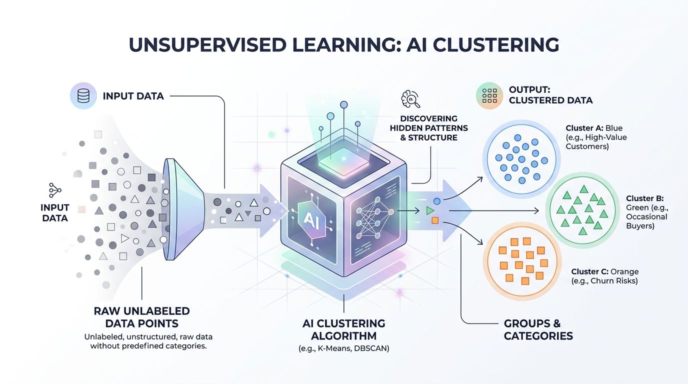

### Workflow Graph
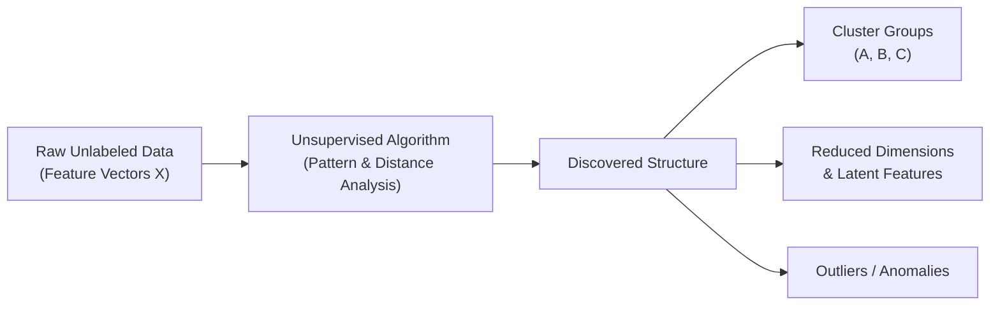

---

## 3. Reinforcement Learning

### Definition
**Reinforcement Learning (RL)** is an interactive learning paradigm where an autonomous **Agent** learns to make sequential decisions by interacting with an **Environment**. The agent takes actions, observes the resulting state changes, and receives numerical feedback in the form of **rewards** (positive reinforcement) or **penalties** (negative reinforcement), with the ultimate goal of maximizing cumulative reward over time.

* **Data Type:** State transitions, actions, and reward signals generated dynamically through interaction.
* **Core Components:**
  * **Agent:** The learner/decision maker.
  * **Environment:** The world the agent navigates.
  * **State ($S_t$):** Current situation of the agent.
  * **Action ($A_t$):** Moves chosen according to a policy ($\pi$).
  * **Reward ($R_t$):** Feedback score reflecting action quality.
* **Common Algorithms:** Q-Learning, Deep Q-Networks (DQN), Policy Gradient, PPO, Actor-Critic.

### Concept Illustration
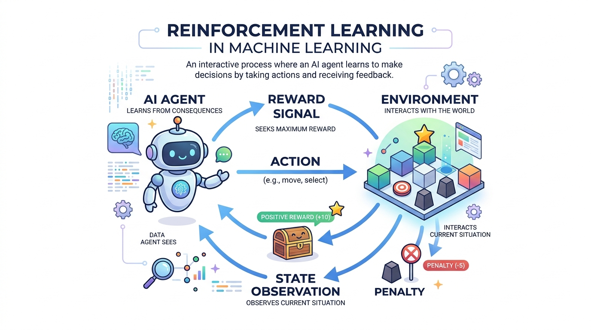

### Interaction Loop Graph
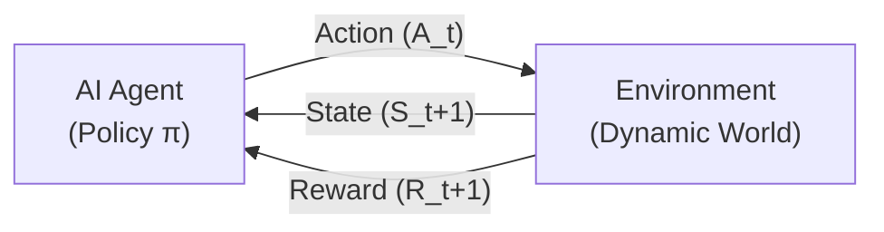

---

## Summary Comparison of Paradigms

| Paradigm | Input Data | Target Output | Feedback Mechanism | Primary Use Cases |
| :--- | :--- | :--- | :--- | :--- |
| **Supervised Learning** | Labeled $(X, y)$ | Direct target label / value | Immediate error signal vs ground truth | Classification, Regression |
| **Unsupervised Learning** | Unlabeled $(X)$ | Clusters, low-dim representation | None (internal similarity/distance metrics) | Segmentation, Compression, Anomaly detection |
| **Reinforcement Learning** | States from environment | Policy / sequence of actions | Delayed reward or penalty from environment | Robotics, Game AI, Autonomous driving |

---

## Essential Machine Learning Libraries

The Python Machine Learning ecosystem is built as a cohesive, layered stack where each library addresses a specific phase of the data science and modeling lifecycle:

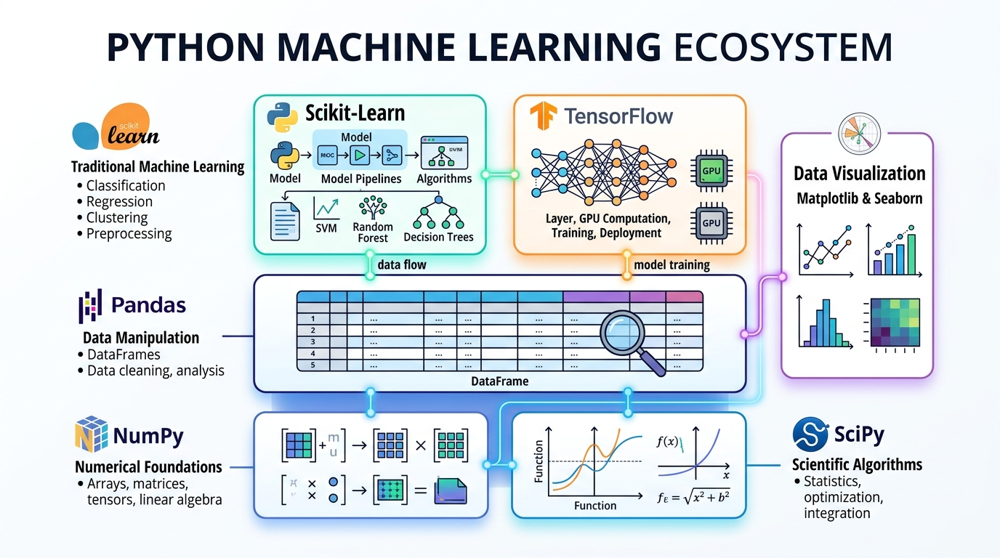

---

### 1. NumPy (Numerical Python)

#### Definition
**NumPy** is the fundamental library for numerical computing in Python. It provides high-performance $N$-dimensional array objects (`ndarray`), routines for fast mathematical operations, linear algebra, Fourier transforms, and random number generation.

#### Working Principle
* **Contiguous Memory Storage:** Unlike standard Python lists that store references to scattered objects in memory (pointer chasing), a NumPy `ndarray` stores homogeneous elements in a contiguous block of memory with fixed byte sizes (`dtype`).
* **Vectorization & SIMD:** Mathematical operations execute in compiled C/Fortran code over entire arrays without Python `for` loops, leveraging CPU SIMD (Single Instruction, Multiple Data) instructions.
* **Broadcasting:** Rules that allow arithmetic operations between arrays of different shapes without unneeded memory copying.

#### Architecture Graph
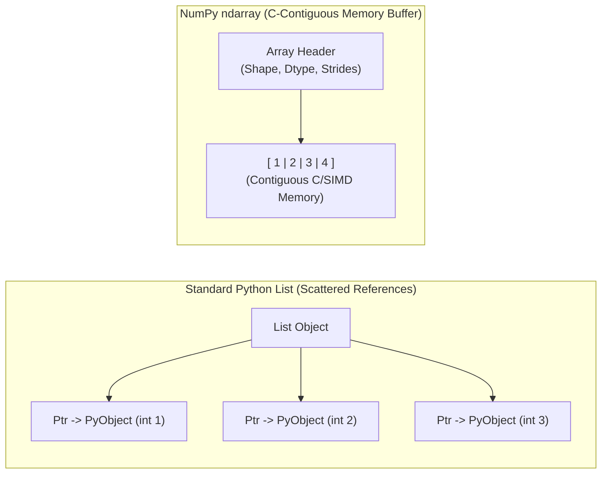

* **Core APIs:** `np.array()`, `np.zeros()`, `np.dot()`, `np.reshape()`, `np.linalg.inv()`.

---

### 2. Pandas (Python Data Analysis Library)

#### Definition
**Pandas** is an open-source data manipulation and analysis library built on top of NumPy. It provides flexible, intuitive data structures—primarily the 1D **Series** and 2D **DataFrame**—to clean, transform, align, and analyze structured tabular data.

#### Working Principle
* **Column-Oriented BlockManager:** A `DataFrame` is essentially a collection of aligned Series indexed by rows and columns. Under the hood, Pandas groups columns of the same datatype into 2D NumPy array "blocks" managed by a `BlockManager`, which optimizes memory locality and vectorized operations across columns.
* **Label Alignment:** Operations between Series/DataFrames automatically align on row and column index labels, preventing mismatched data bugs.
* **Missing Value Handling:** Native detection and propagation of missing values (`NaN`, `None`, `pd.NA`).

#### Architecture Graph
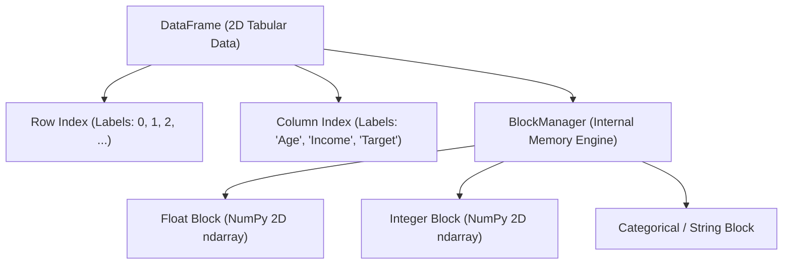

* **Core APIs:** `pd.read_csv()`, `df.groupby()`, `df.merge()`, `df.loc[]`, `df.fillna()`.

---

### 3. SciPy (Scientific Python)

#### Definition
**SciPy** is a collection of mathematical algorithms and convenience functions built on NumPy. It extends NumPy's basic capabilities with high-level modules for optimization, numerical integration, signal processing, linear algebra, and statistics.

#### Working Principle
* **Low-Level Wrapper Engine:** SciPy interfaces NumPy arrays directly with industry-standard, time-tested Fortran and C scientific libraries, including **LAPACK** (Linear Algebra PACKage), **BLAS** (Basic Linear Algebra Subprograms), **FFTW** (Fastest Fourier Transform in the West), and **QUADPACK** (numerical quadrature).
* **Domain Subpackages:** Code is modularized into specialized packages for specific mathematical domains without reinventing numerical recipes.

#### Architecture Graph
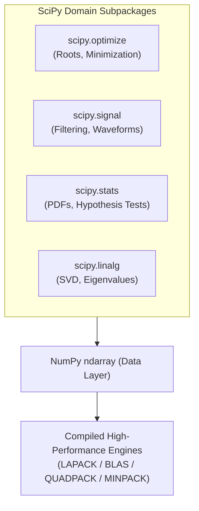

* **Core APIs:** `scipy.optimize.minimize()`, `scipy.stats.norm()`, `scipy.signal.convolve()`, `scipy.integrate.quad()`.

---

### 4. Matplotlib

#### Definition
**Matplotlib** is the foundational 2D/3D plotting and data visualization library in Python. It provides fine-grained, publication-quality static, animated, and interactive visualizations.

#### Working Principle
* **Hierarchical Object-Oriented Architecture:** Every visualization consists of three architectural layers:
  1. **Backend Layer:** Interacts with the operating system or file output formats (e.g., Agg, PDF, SVG, TkAgg).
  2. **Artist Layer:** Everything visible on the canvas is an `Artist` object (e.g., `Figure`, `Axes`, `Axis`, `Line2D`, `Text`).
  3. **Scripting Layer (`pyplot`):** A state-machine interface that mimics MATLAB for rapid, interactive plotting.
* **Figure vs. Axes:** The `Figure` represents the entire drawing canvas/window, while each `Axes` represents a single plot area with its own coordinate system.

#### Architecture Graph
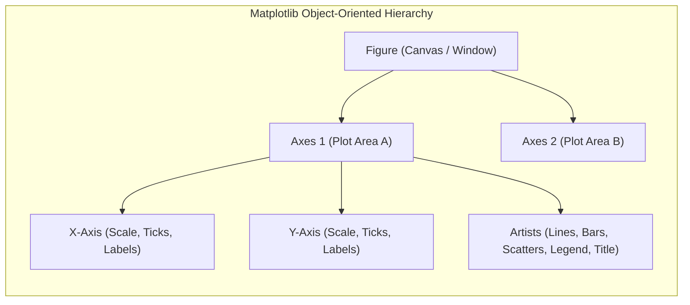

* **Core APIs:** `plt.subplots()`, `ax.plot()`, `ax.scatter()`, `ax.set_title()`, `plt.show()`.

---

### 5. Seaborn

#### Definition
**Seaborn** is a statistical data visualization library built directly on top of Matplotlib and integrated closely with Pandas data structures. It provides high-level APIs for creating attractive, informative statistical graphics.

#### Working Principle
* **Declarative Semantic Mapping:** Seaborn automatically maps DataFrame columns to graphical visual aesthetics such as color (`hue`), marker shapes (`style`), and point dimensions (`size`).
* **Automated Statistical Inference:** When drawing charts, Seaborn automatically aggregates data, computes central tendencies (means, medians), estimates bootstrap confidence intervals (CI), or generates kernel density estimations (KDE) before rendering via Matplotlib.

#### Architecture Graph
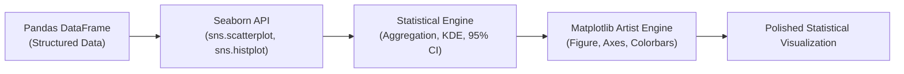

* **Core APIs:** `sns.set_theme()`, `sns.scatterplot()`, `sns.heatmap()`, `sns.pairplot()`, `sns.boxplot()`.

---

### 6. Scikit-learn

#### Definition
**Scikit-learn** is the premier Python library for classical (non-deep) machine learning. Built upon NumPy, SciPy, and Matplotlib, it offers accessible tools for data preprocessing, model selection, classification, regression, and clustering.

#### Working Principle
* **Unified Object-Oriented Estimator Interface:** All algorithms strictly conform to a standardized contract:
  * **Estimators:** `fit(X, y)` trains the algorithm on data.
  * **Transformers:** `transform(X)` or `fit_transform(X)` preprocesses/scales features.
  * **Predictors:** `predict(X)` or `predict_proba(X)` generates predictions on new data.
* **Pipeline Encapsulation:** Chains data preprocessing, feature selection, and model training into a single leak-free pipeline, ensuring cross-validation consistency.

#### Architecture Graph
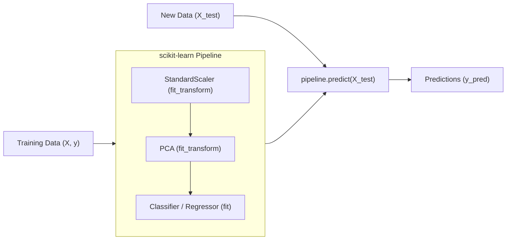

* **Core APIs:** `Pipeline()`, `train_test_split()`, `StandardScaler()`, `RandomForestClassifier()`, `GridSearchCV()`.

---

### 7. TensorFlow

#### Definition
**TensorFlow** is an end-to-end open-source machine learning and deep learning platform developed by Google. It enables developers to design, train, and deploy complex neural networks across diverse computing architectures (CPUs, GPUs, and TPUs).

#### Working Principle
* **Tensors & Computational Graphs:** Data is represented as multidimensional arrays called **Tensors**. Operations form an internal computational Directed Acyclic Graph (DAG) that optimizes mathematical execution.
* **Automatic Differentiation (`tf.GradientTape`):** TensorFlow records forward-pass operations on a "tape" and applies reverse-mode automatic differentiation (backpropagation) to calculate exact gradients of loss with respect to all trainable weights.
* **XLA & Hardware Acceleration:** Accelerated Linear Algebra (XLA) compiler fuses operations and generates optimized machine code for high-throughput GPU/TPU execution. High-level model creation is handled via **tf.keras**.

#### Architecture Graph
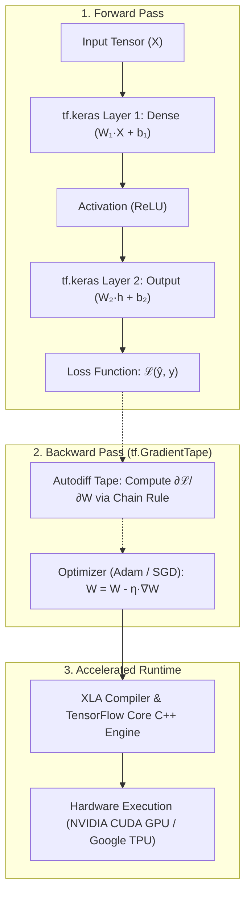

* **Core APIs:** `tf.constant()`, `tf.GradientTape()`, `tf.keras.Sequential()`, `tf.keras.layers.Dense()`, `model.compile()`.

---

## Library Stack Summary Matrix

| Library | Primary Domain | Core Data Structure | Key Working Principle | Built On Top Of |
| :--- | :--- | :--- | :--- | :--- |
| **NumPy** | Numerical array computing | `ndarray` ($N$-dim array) | Contiguous C-memory, SIMD vectorization, broadcasting | C / Python |
| **Pandas** | Tabular data manipulation | `Series` (1D), `DataFrame` (2D) | BlockManager grouping columns, automatic index alignment | NumPy |
| **SciPy** | Scientific & engineering algorithms | Specialized functions & arrays | Wraps optimized BLAS, LAPACK, FFTW, QUADPACK routines | NumPy |
| **Matplotlib** | Low-level data visualization | `Figure`, `Axes`, `Artists` | Hierarchical canvas/artist object model with rendering backends | Python, NumPy |
| **Seaborn** | High-level statistical plotting | Pandas DataFrames & Series | Declarative semantic mapping, built-in statistical estimation | Matplotlib, Pandas |
| **Scikit-learn** | Classical machine learning | NumPy arrays / Pandas DataFrames | Unified `fit()`, `transform()`, `predict()` estimator pipeline | NumPy, SciPy, Matplotlib |
| **TensorFlow** | Deep learning & neural networks | `tf.Tensor` ($N$-dim tensor) | Computational graphs, automatic differentiation (`GradientTape`), XLA | C++, CUDA |
